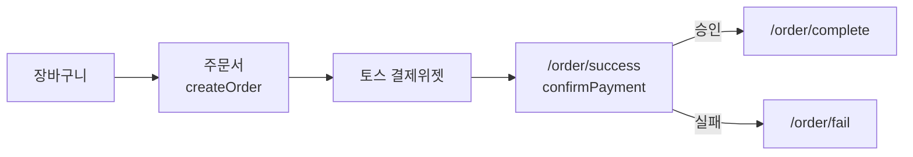

<p align="center">
  
</p>

<p align="center">
  
  
  
  
  
  
</p>

<p align="center">
  <b>패션 쇼핑몰의 상품 탐색부터 결제, 게시판, 관리자 화면까지 한 흐름으로 만든 프론트엔드 팀 프로젝트</b><br>
  <i>KANT Agentic AI 1기 Team D · 디스코 닌자 (Disco Ninja)</i>
</p>

<p align="center">
  <a href="#팀-구성과-담당">팀 소개</a> / <a href="#협업-과정">협업 과정</a> / <a href="#프로젝트-구조">프로젝트 구조</a> / <a href="#주요-흐름">주요 흐름</a> / <a href="#실행-방법">실행 방법</a>
</p>

## 프로젝트 소개

DN Mall은 패션 상품을 둘러보고 장바구니에 담아 결제하는 쇼핑몰입니다. 처음에는 목업 데이터로 화면을 만들었고, 지금은 **Supabase(Postgres · 로그인 · Storage)** 와 **토스페이먼츠 결제**에 연결되어 있습니다. 화면은 Next.js App Router의 서버 컴포넌트와 Server Actions로 그리고, 기능별 코드는 `domains/` 아래에 모아 팀원이 나누어 맡았습니다. |

| 구성   | 내용                                                                                |
| ------ | ----------------------------------------------------------------------------------- |
| 프론트 | Next.js 16 (App Router · Server Actions · Cache Components) · React 19 · TypeScript |
| 스타일 | Tailwind CSS 4 · shadcn/ui · Base UI · lucide-react · react-icons · Swiper          |
| 백엔드 | Supabase (`@supabase/ssr`, `@supabase/supabase-js`) — Auth · Postgres · Storage     |
| 결제   | 토스페이먼츠 결제위젯 (`@tosspayments/tosspayments-sdk`)                            |
| 상태   | Zustand (장바구니 개수 · 주문서, 주문서는 sessionStorage에 유지)                    |
| 도구   | ESLint · Prettier · `node --test` + tsx · Docker                                    |
| 협업   | Git, GitHub, Notion, Slack                                                          |

## 팀 구성과 담당

| 이름   | GitHub                                    | 주요 담당                                                                                                |
| ------ | ----------------------------------------- | -------------------------------------------------------------------------------------------------------- |
| 정현구 | [qwwe132](https://github.com/qwwe132)     | 관리자(카테고리 · 상품 · 주문), 헤더 카테고리 · 관리자 버튼, 파일 첨부 · 이미지 구조, 프로젝트 전반 리드 |
| 이명지 | [mjlee0914](https://github.com/mjlee0914) | 초기 디자인 · 구조 기획, 메인(이벤트 배너 · 인기 상품), 헤더 · 푸터, 주문서(체크아웃) 화면               |
| 배유민 | [imeab](https://github.com/imeab)         | 상품 상세(옵션 · 품절 표시), 상품 검색 · 가격 필터 · 페이지네이션, 상품 이미지 연동, 목데이터 및 DB 시딩 |
| 최지훈 | [Aiopenjh](https://github.com/Aiopenjh)   | 초기 DB 기획, 로그인 · 회원가입, 장바구니 · 추천 상품, 토스 결제 연결, 마이페이지, 자동 로그아웃         |
| 이승주 | [eeseuju](https://github.com/eeseuju)     | 게시판 전반(공지 · 이벤트 · FAQ · 문의 · 리뷰 · 자유 · 룩북), 상품 상세의 리뷰 · 문의                    |

## 협업 과정

기능별로 작업 브랜치를 나누고, 변경을 Pull Request로 올려 리뷰를 거쳐 `main`에 합쳤습니다.  
브랜치 이름은 `feature/이니셜-작업명` 형태입니다. (예: `feature/lsj-board-product`, `feature/cjh-cart`)

```text
담당 기능 구현 → 작업 브랜치에 커밋 → push → Pull Request → 리뷰 → main에 병합
```

- 코드는 기능 단위(`domains/`)와 공용(`shared/`)으로 나누어 담당 영역이 겹치지 않게 했습니다.
- 커밋 메시지는 `feat:` `fix:` `docs:` `style:` `chore:` 접두사를 씁니다.
- `npm run build` 전에 `prebuild`가 테스트를 먼저 돌립니다.

## 프로젝트 구조

URL은 `app/`, 기능 코드는 `domains/`, 여러 곳에서 쓰는 것은 `shared/`가 맡습니다.

```text
FE-project-teamD/
├─ app/
│  ├─ (shop)/                 # 쇼핑몰 레이아웃(헤더·푸터) 아래 모든 화면
│  │  ├─ page.tsx             # 메인
│  │  ├─ (auth)/              # login · register
│  │  ├─ products/            # 목록 · [id] 상세
│  │  ├─ cart/ checkout/      # 장바구니 · 주문서
│  │  ├─ order/               # success(결제 승인) · complete · fail
│  │  ├─ mypage/
│  │  └─ boards/              # support · community · [boardId] (목록·상세·작성·수정)
│  └─ admin/                  # 관리자: products · category · orders (ADMIN만)
├─ domains/                   # 기능별 코드 (actions · components · queries · types · utils)
│  ├─ home/ products/ categories/
│  ├─ auth/ cart/ orders/
│  ├─ boards/                 # 게시판 (설정은 lib/boardSettings.ts)
│  └─ admin/ files/
├─ shared/                    # 헤더·푸터, 공용 UI, 스토어, 공용 타입·유틸
├─ lib/                       # supabase(서버) · supabase.client(브라우저) · cn
├─ components/ui/             # shadcn/ui
├─ public/                    # 로고 · 이벤트 배너 · 상품 이미지
├─ Dockerfile docker-compose.yml
└─ .env.example               # 환경변수 예시
```

도메인 안은 역할별 폴더로 나뉩니다.

| 폴더              | 역할                                                         |
| ----------------- | ------------------------------------------------------------ |
| `actions/`        | 쓰기 동작 (Server Actions: 로그인, 주문 생성, 게시글 작성 …) |
| `queries/`        | 읽기 동작 (Supabase 조회)                                    |
| `components/`     | 화면 조각                                                    |
| `types/` `utils/` | 타입과 검증·계산 함수                                        |

### DB 테이블

Supabase에서 사용하는 테이블입니다. 스키마 자체는 저장소에 없으므로 팀 Supabase 프로젝트를 기준으로 합니다.

| 영역   | 테이블                                                              |
| ------ | ------------------------------------------------------------------- |
| 상품   | `products` · `product_variants` · `category`                        |
| 회원   | `profiles` (`role`이 `ADMIN`이면 관리자)                            |
| 구매   | `cart_items` · `orders` · `order_items` · `order_logs` · `payments` |
| 게시판 | `boards` · `posts` · `post_answers`                                 |
| 파일   | `file_group` · `file_info` · `attachments` (+ Storage 버킷)         |

## 주요 흐름

### 영역별 주요 기능

| 영역   | 내용                                                                                                |
| ------ | --------------------------------------------------------------------------------------------------- |
| 상품   | 메인(이벤트 배너 · 인기 상품), 카테고리 · 검색 · 가격 필터 · 페이지네이션, 상품 상세(옵션 · 이미지) |
| 회원   | 로그인 · 회원가입, 마이페이지(프로필), 30분 동안 서버 동작이 없으면 자동 로그아웃                   |
| 구매   | 장바구니(추천 상품), 주문서(배송지), 토스 결제 → 주문 완료 · 실패 화면                              |
| 게시판 | 공지 · 이벤트 · FAQ · 1:1 문의 · 상품 리뷰 · 자유게시판 · 룩북, 상품 상세 안의 리뷰 · 문의          |
| 관리자 | 카테고리 · 상품(옵션 포함) · 주문 관리, `ADMIN` 역할만 접근                                         |

### 결제



- 승인 후 서버가 `payments`·`orders`에 결과를 반영합니다.
- 배송비는 5만 원 미만 3,000원, 5만 원 이상 무료입니다.

### 게시판

- 게시판 종류·쓰기 권한·옵션(비밀글, 첨부, 카테고리, 갤러리 형태)은 DB가 아니라 [boardSettings.ts](domains/boards/lib/boardSettings.ts)에서 코드로 관리합니다.

| 쓰기 권한   | 게시판                                   |
| ----------- | ---------------------------------------- |
| 관리자      | 공지 · 이벤트 · FAQ                      |
| 로그인 회원 | 1:1 문의 · 상품 리뷰 · 자유게시판 · 룩북 |

- 상품 리뷰는 구매한 상품에만 쓸 수 있습니다.

### 권한과 세션

- **관리자**: `app/admin/layout.tsx`에서 로그인과 `ADMIN` 역할을 확인합니다. 비로그인은 `/login`, 일반 회원은 `/`로 보냅니다.
- **자동 로그아웃**: 서버 Supabase 쿠키 수명을 30분으로 두어, 그 시간 동안 로그인·담기 같은 서버 동작이 없으면 로그아웃됩니다.

## 실행 방법

### 준비

- Node.js 22 이상, npm
- Supabase 프로젝트 (팀 DB 접속 정보는 팀 안에서 따로 공유)
- 토스페이먼츠 테스트 키 ([공개 테스트 키 안내](https://docs.tosspayments.com/reference/using-api/api-keys))

### 설치 · 실행

```bash
git clone https://github.com/mjlee0914/FE-project-teamD.git
cd FE-project-teamD
npm install
```

`.env.example`을 `.env.local`로 복사하고 값을 채웁니다. **`.env.local`은 git에 올리지 않습니다.**

```bash
NEXT_PUBLIC_SUPABASE_URL=
NEXT_PUBLIC_SUPABASE_PUBLISHABLE_KEY=
NEXT_PUBLIC_TOSS_CLIENT_KEY=
TOSS_SECRET_KEY=            # 서버에서만 사용, 절대 NEXT_PUBLIC_ 을 붙이지 않습니다
```

```bash
npm run dev      # http://localhost:3000
```

### 스크립트

| 명령             | 내용                                     |
| ---------------- | ---------------------------------------- |
| `npm run dev`    | 개발 서버                                |
| `npm run build`  | 프로덕션 빌드 (먼저 `npm run test` 실행) |
| `npm start`      | 빌드 결과 실행                           |
| `npm run test`   | 테스트 (`node --import tsx --test`)      |
| `npm run lint`   | ESLint                                   |
| `npm run format` | Prettier 적용 (`format:check`는 검사만)  |

### Docker

```bash
docker compose up --build   # http://localhost:3000, .env.local 사용
```
